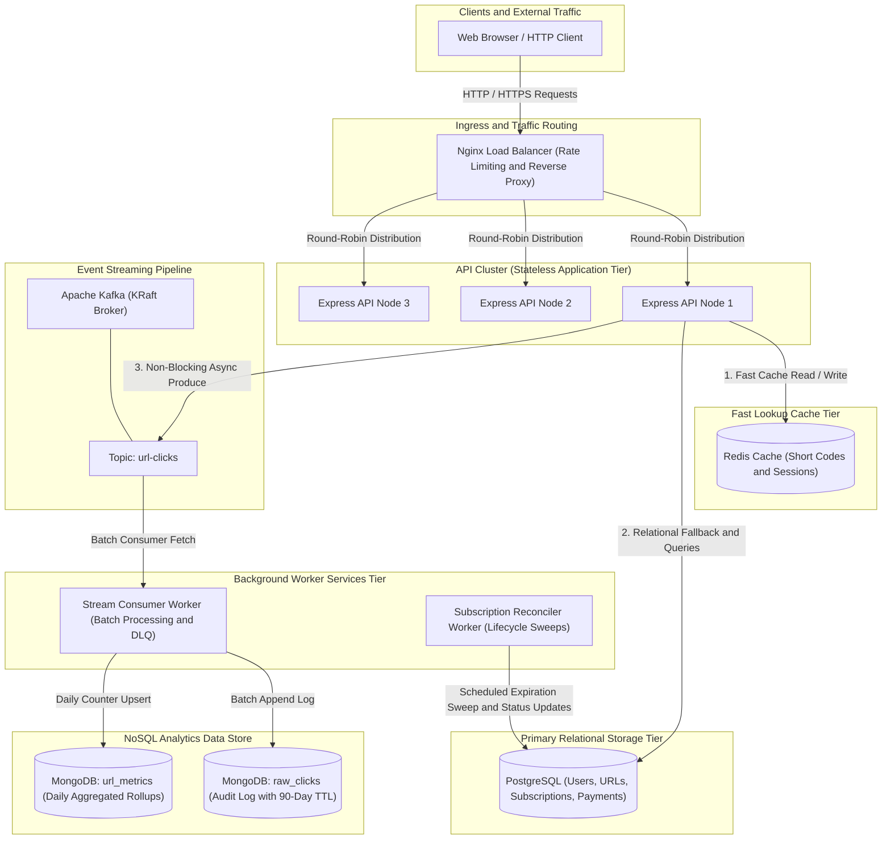

# URL Shortener

This is a personal learning project to build a scalable URL shortener with analytics and background workers.

---

## Architecture

The system uses a layered architecture to keep URL redirection fast while handling analytics and background maintenance asynchronously.

### How the Data Flows

1. **URL Redirection**: Incoming redirect requests hit Nginx, which applies rate limiting and load balances across API instances.
2. **Caching Strategy**: The API first checks Redis for the short code. On a cache hit, it redirects immediately. On a cache miss, it reads from PostgreSQL, updates Redis, and redirects the client.
3. **Async Analytics Pipeline**: During redirection, the API publishes a sanitized click event to Apache Kafka without waiting for storage operations, keeping user response times low.
4. **Stream Processing**: The stream consumer worker consumes batches of click events from Kafka and writes them into MongoDB, updating both raw audit records and daily pre-aggregated metrics.
5. **Subscription Reconciliation**: An independent background worker periodically queries PostgreSQL for subscriptions past their billing period and transitions them to inactive status.

---

## Features

- **Fast URL Shortening and Redirection**: Generates obfuscated Base62 short codes with format-preserving encryption and resolves links quickly using Redis caching.
- **Asynchronous Click Analytics**: Captures visitor data (device, browser, country, referer) and streams events through Kafka to avoid slowing down redirects.
- **Dual Analytics Storage**: Stores append-only audit click records alongside fast pre-aggregated daily summaries in MongoDB.
- **Pre-Aggregated Metrics APIs**: Exposes endpoints for both high-level aggregated metrics rollups and deep raw click inspection.
- **Background Subscription Reconciler**: Automatically identifies expired customer subscriptions in PostgreSQL and handles status transitions.
- **Security and Authentication**: Implements JWT authentication, Argon2 password hashing with secret peppers, and timing-safe signature verification.
- **Cluster Overload Protection**: Uses Nginx leaky-bucket rate limiting and multi-replica round-robin upstream balancing.
- **Containerized Deployment**: Includes Docker configurations and docker compose setups for development and production environments.
